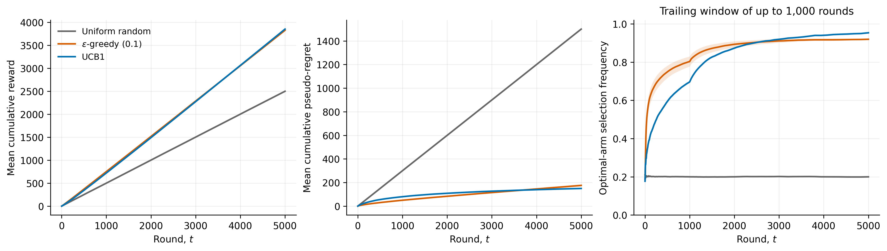
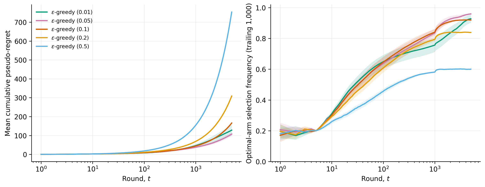
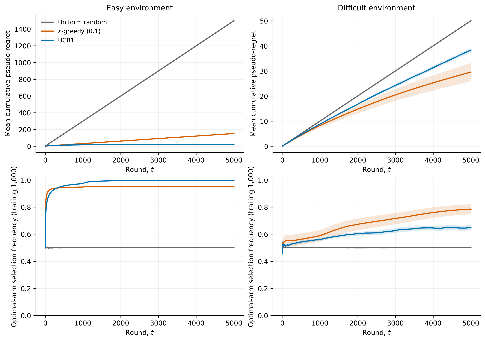
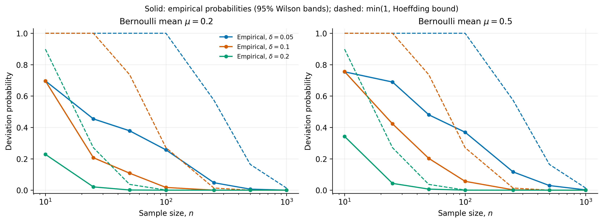
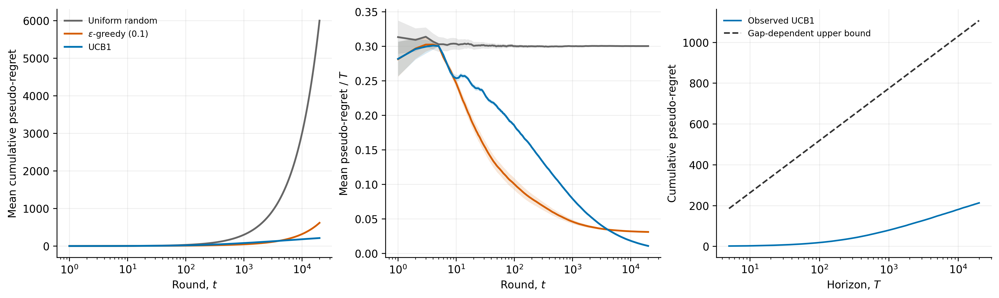

# Exploration vs. Exploitation: A Probabilistic Study of Multi-Armed Bandits

**ESTR2018: Probability for Engineers — The Chinese University of Hong Kong**

## Abstract

This project compares uniform random selection, fixed-ε ε-greedy, and UCB1 in stationary Bernoulli bandits. Five reproducible experiments examine learning curves, exploration probabilities, reward gaps, concentration, and regret scaling. Three hundred independent trials per bandit setting and trial-based uncertainty intervals distinguish systematic behavior from simulation variation. UCB1 has the lowest mean regret in the main five-arm comparison and the easy two-arm environment; fixed-ε greedy performs better in the difficult two-arm environment over the simulated horizon. A derivation from Hoeffding's inequality explains UCB1's optimism bonus, and a proof sketch explains its logarithmic expected regret guarantee. Finite simulations illustrate the theory's consequences without proving its asymptotic conclusions.

## 1. Introduction

A decision maker repeatedly selects one of several uncertain reward sources. Selecting the currently most promising source earns reward, but sampling other sources may reveal a better alternative. This exploration–exploitation trade-off is a basic example of sequential decision making under uncertainty [1, Chapter 2]. Our research question is: **How does probability theory enable efficient exploration in stochastic bandits, and how do fixed-ε greedy and UCB1 compare in expected cumulative regret and performance guarantees?**

The scope is deliberately limited to stationary, independent Bernoulli rewards. There are no state transitions, deep learning models, or adversarial rewards. This allows concentration inequalities and expected values to connect directly to implementable algorithms.

## 2. Problem formulation

There are K arms. Arm i produces an independent sequence Xᵢ,₁, Xᵢ,₂, … of identically distributed Bernoulli(μᵢ) rewards, with unknown, fixed μᵢ ∈ [0,1]. Rewards are independent across arms as well. Thus

$$\Pr(X_{i,s}=1)=\mu_i,\quad \mathbb E[X_{i,s}]=\mu_i,\quad \operatorname{Var}(X_{i,s})=\mu_i(1-\mu_i).$$

Before round t, the policy chooses Aₜ using only past observations and its own randomness, independent of unrevealed rewards. Define μ* = maxᵢ μᵢ and Δᵢ = μ* − μᵢ. Let Nᵢ(t) count pulls **before** round t, and write Mᵢ(T) = Nᵢ(T+1) for total pulls through T. The empirical mean after n observations is

$$\widehat\mu_{i,n}=\frac1n\sum_{s=1}^{n}X_{i,s}.$$

For fixed n this estimator is unbiased with variance μᵢ(1−μᵢ)/n. An adaptively stopped mean need not be unbiased, so fixed-sample properties must not be applied blindly to random pull counts.

Three quantities must be distinguished:

1. **Realized cumulative reward:** C(T) = Σₜ Xₜ, where Xₜ is the observed reward of Aₜ. This contains Bernoulli sampling noise.
2. **Sample-path pseudo-regret:** G(T) = Σₜ Δ₍Aₜ₎ = Σᵢ Δᵢ Mᵢ(T). This is random because actions depend on observations, but removes the extra noise in realized rewards. Every increment is nonnegative.
3. **Expected cumulative regret:**

$$R(T)=T\mu^*-\mathbb E\!\left[\sum_{t=1}^T\mu_{A_t}\right]
=\mathbb E[G(T)]=\sum_i\Delta_i\mathbb E[M_i(T)].$$

Nonanticipating choices imply E[Xₜ | history, Aₜ] = μ₍Aₜ₎, so also R(T) = Tμ* − E[C(T)]. The realized shortfall Tμ* − C(T) can be negative; G(T) cannot. Its expectation agrees with expected regret, but the two pathwise quantities are different. We estimate R(T) by the average of G(T) across independent trials.

## 3. Probability theory and Hoeffding's inequality

For independent X₁,…,Xₙ ∈ [0,1] with common mean μ, Hoeffding's inequality [3] gives, for δ > 0,

$$\Pr(\widehat\mu_n-\mu\geq\delta)\leq e^{-2n\delta^2},\qquad
\Pr(\mu-\widehat\mu_n\geq\delta)\leq e^{-2n\delta^2}.$$

Taking a union of the two tails yields

$$\Pr(|\widehat\mu_n-\mu|\geq\delta)\leq\min\{1,2e^{-2n\delta^2}\}.$$

The exponential dependence on n explains why repeated observations improve accuracy. The bound holds for all distributions supported in [0,1], so it discards information about Bernoulli variance and discreteness. It is an upper bound, not a prediction of the exact tail probability.

**Derivation of the bonus.** For a fixed arm and sample size n, choose a one-sided error allowance t⁻⁴. Solving exp(−2nb²) = t⁻⁴ gives

$$b(t,n)=\sqrt{\frac{2\ln t}{n}}.$$

Adding this radius to the empirical mean gives an optimistic index:

$$\mathrm{UCB}_i(t)=\widehat\mu_{i,N_i(t)}+\sqrt{\frac{2\ln t}{N_i(t)}}.$$

Natural logarithms are used throughout. A rarely sampled arm receives a larger bonus; an arm repeatedly observed receives a smaller one. Indices may exceed 1: they are scores and need not be clipped to the Bernoulli support.

**Adaptive sampling caveat.** The t⁻⁴ statement above holds at fixed n. Substituting a data-dependent Nᵢ(t) does not preserve that error probability automatically. The regret argument below unions over all possible deterministic counts. We do not describe the indices as a simultaneous 95% confidence sequence; the 95% bands in the figures are separate Monte Carlo intervals.

**Gap and identification intuition.** For two arms separated by Δ, estimating each mean to strictly within Δ/2 suffices to rank them correctly. For n samples per arm, the union bound gives failure probability at most 4 exp(−nΔ²/2). A sufficient sample size is approximately 2Δ⁻² ln(4/α) to make this at most α, with strict inequalities or a slightly smaller error radius to rule out ties. Reducing the gap from 0.6 to 0.02 increases this sufficient sample size by a factor of 900 at the same α. This is a sufficient concentration-based comparison, not an exact identification complexity; reward variances also differ between our environments.

## 4. Algorithms

**Uniform random.** Every round selects an arm independently and uniformly. Its exact expected regret is TΣᵢΔᵢ/K, giving an analytic baseline for simulation checks.

**Fixed-ε greedy.** Each arm is first pulled once in a random order. Thereafter the policy explores with probability ε, choosing uniformly among all K arms, including the optimal arm. Otherwise it maximizes the empirical mean. Exact empirical ties are broken uniformly. Forced initialization is part of the specified implementation; its cost is included in all totals. We examine ε ∈ {0.01, 0.05, 0.1, 0.2, 0.5}, with ε = 0.1 used in the main comparison.

**UCB1.** Each arm is pulled once in a random order. At the upcoming one-based round t, the policy maximizes the index above using counts before that round. Index ties are broken uniformly. Means update incrementally as m ← m + (x−m)/n after incrementing the selected arm's count. Randomized initialization and tie handling do not change the standard regret argument, which only requires each arm be sampled initially and subsequent choices maximize the index.

The implementation separates the environment, policy state, simulation orchestration, and plotting. NumPy vectorizes independent trials; rounds still run sequentially, preserving the dependence of each decision on its own past.

## 5. Experimental setup

The authoritative configuration is [config.json](../config.json). The default seed is 2018. Each bandit experiment uses 300 trials. Experiments 1–3 run for 5,000 rounds; experiment 5 runs to 20,000 rounds with checkpoints at 100, 250, 500, 1,000, 2,000, 5,000, 10,000, and 20,000. Each Hoeffding cell uses 100,000 independent binomial replications.

| Experiment | Environment and comparisons | Purpose |
| --- | --- | --- |
| 1 | [0.2, 0.35, 0.5, 0.65, 0.8]; random, ε = 0.1, UCB1 | Reward, regret, optimal-arm frequency |
| 2 | Same five means; five fixed ε values | Exploration cost and finite-horizon learning |
| 3 | Easy [0.2, 0.8], difficult [0.49, 0.51]; all three policies | Gap effects |
| 4 | μ ∈ {0.2, 0.5}; n ∈ {10,25,50,100,250,500,1000}; δ ∈ {0.05,0.1,0.2} | Concentration probabilities |
| 5 | Main five-arm environment; all three policies | Regret over increasing horizons |

**Randomness and fairness.** Stable SHA-256 keys create named SeedSequence streams for each experiment, trial, and stream role; PCG64 is explicit. Reward tables are indexed by arm and its within-arm pull number. Policies in the same trial share these potential reward sequences, so their outcomes are paired without changing any policy's marginal Bernoulli model. Policy decision streams are separate for every policy and trial. Experiments have different keys and therefore different trials. Policy order does not change results. No policy receives another policy's observations or future rewards.

**Uncertainty.** Learning curves and tables report the mean ± 1.96 s/√300 across trial-level values, an approximate pointwise 95% Monte Carlo confidence interval. These intervals estimate simulation means, not variability of a single future run, and do not provide simultaneous coverage over all rounds or parameter settings. Overlapping curves and horizons are correlated. Algorithm contrasts use paired trial differences, with their own across-trial standard errors. No independence across horizons is assumed. Optimal-arm frequency is measured over a trailing window of min(t,1000) rounds in each trial and then averaged; cumulative fractions are also saved.

For Hoeffding event probabilities, Wilson intervals avoid falsely reporting zero uncertainty when no event is observed. Binomial counts exactly represent sums of Bernoulli variables. The event uses ≥, with a 10⁻¹² numerical tolerance to include equality at decimal lattice boundaries; exact binomial sums use the same event.

**Saved evidence.** CSVs retain aggregate curves, checkpoint values for every trial, final per-arm pull counts, Hoeffding event counts, and paired contrasts. Metadata stores configurations and software versions. Full action histories and potential outcome tables are regenerated from seeds rather than stored. Figures are produced from saved CSVs and exported at 300 dpi in PNG plus vector PDF. Documentation tables are regenerated from checkpoint data by `python -m tools.build_report`.

## 6. Results and discussion

All intervals in this section are pointwise 95% confidence intervals unless stated otherwise. The numerical sections below are generated from the committed CSVs.

### 6.1 Algorithm comparison

<!-- BEGIN comparison -->
| Policy | Cumulative reward (95% CI) | Pseudo-regret (95% CI) | Optimal frequency, last 1,000 (95% CI) |
| --- | --- | --- | --- |
| Uniform random | 2499.17 [2495.44, 2502.89] | 1500.19 [1498.52, 1501.86] | 0.1996 [0.1981, 0.2012] |
| ε-greedy (0.1) | 3826.09 [3817.78, 3834.41] | 175.84 [168.49, 183.20] | 0.9194 [0.9175, 0.9214] |
| UCB1 | 3850.90 [3846.93, 3854.88] | 149.95 [147.81, 152.10] | 0.9534 [0.9498, 0.9571] |
<!-- END comparison -->

UCB1 has lower final mean regret than ε = 0.1 in this environment, although ε-greedy learns faster initially. Its bonus supports early exploration and then increasingly favors the best arm. Random selection yields approximately the exact expected regret of 1,500 and an optimal-arm frequency of 0.2. Because μ* = 0.8, the expected reward benchmark is 4,000; differences between observed mean rewards and 4,000 minus mean pseudo-regret reflect finite-trial reward noise.

### 6.2 Impact of ε

<!-- BEGIN epsilon -->
| ε | Pseudo-regret (95% CI) | Median regret | 95th percentile regret | Last-1,000 optimal frequency (95% CI) |
| --- | --- | --- | --- | --- |
| 0.01 | 128.37 [100.01, 156.73] | 19.73 | 758.86 | 0.9284 [0.9011, 0.9558] |
| 0.05 | 107.50 [98.46, 116.54] | 82.05 | 262.55 | 0.9596 [0.9586, 0.9606] |
| 0.1 | 166.08 [161.79, 170.38] | 156.22 | 230.33 | 0.9199 [0.9189, 0.9209] |
| 0.2 | 308.80 [306.71, 310.89] | 306.07 | 336.49 | 0.8391 [0.8378, 0.8404] |
| 0.5 | 753.40 [751.79, 755.01] | 753.37 | 777.48 | 0.6004 [0.5985, 0.6022] |
<!-- END epsilon -->

Among these tested values, ε = 0.05 has the smallest estimated final mean regret. This is a comparison on one environment and horizon, not a universal recommendation. The very small exploration rate ε = 0.01 has much greater between-trial variation and a long upper tail: some runs spend substantial time exploiting a suboptimal estimate. Larger ε values learn reliably but keep paying for exploration. Even after perfect identification, the optimal arm is selected with probability 1−ε+ε/K, explaining the frequency ceilings visible in the curves.

### 6.3 Impact of reward gaps

<!-- BEGIN gaps -->
| Environment | Policy | Pseudo-regret (95% CI) | Last-1,000 optimal frequency (95% CI) |
| --- | --- | --- | --- |
| easy | Uniform random | 1498.09 [1495.82, 1500.36] | 0.5003 [0.4986, 0.5020] |
| easy | ε-greedy (0.1) | 151.37 [150.20, 152.53] | 0.9498 [0.9490, 0.9506] |
| easy | UCB1 | 23.89 [23.37, 24.40] | 0.9982 [0.9980, 0.9984] |
| difficult | Uniform random | 50.01 [49.93, 50.09] | 0.4997 [0.4980, 0.5013] |
| difficult | ε-greedy (0.1) | 29.57 [25.93, 33.21] | 0.7850 [0.7480, 0.8221] |
| difficult | UCB1 | 38.31 [37.46, 39.16] | 0.6483 [0.6289, 0.6678] |
<!-- END gaps -->

In the easy environment, UCB1 quickly concentrates its selections on the optimal arm. In the difficult environment, ε = 0.1 has lower mean regret and higher recent optimal-arm frequency than UCB1 at 5,000 rounds. A gap of 0.02 is small relative to the confidence bonuses over this horizon, so UCB1 continues substantial exploration. This finite-horizon ordering is compatible with UCB1's guarantee, whose constants worsen as gaps shrink.

Absolute regret is smaller in the difficult environment even though identification is harder: every suboptimal pull costs only 0.02 instead of 0.6. Thus regret magnitudes across these environments alone do not measure identification success; the optimal-arm frequencies supply the complementary evidence.

### 6.4 Empirical concentration

For μ = 0.5 and δ = 0.1:

<!-- BEGIN hoeffding -->
| n | Events / replications | Empirical probability (Wilson 95% CI) | Exact binomial probability | Hoeffding bound, capped at 1 |
| --- | --- | --- | --- | --- |
| 10 | 75598 / 100000 | 0.755980 [0.753308, 0.758632] | 0.753906 | 1 |
| 25 | 42276 / 100000 | 0.422760 [0.419701, 0.425825] | 0.424356 | 1 |
| 50 | 20236 / 100000 | 0.202360 [0.199881, 0.204861] | 0.202639 | 0.735759 |
| 100 | 5634 / 100000 | 0.056340 [0.054928, 0.057786] | 0.0568879 | 0.270671 |
| 250 | 215 / 100000 | 0.002150 [0.001881, 0.002457] | 0.0018833 | 0.0134759 |
| 500 | 0 / 100000 | 0.000000 [0.000000, 0.000038] | 8.94007e-06 | 9.07999e-05 |
| 1000 | 0 / 100000 | 0.000000 [0.000000, 0.000038] | 2.72846e-10 | 4.12231e-09 |
<!-- END hoeffding -->

The full CSV includes all 42 preconfigured cells. Empirical probabilities are broadly consistent with their exact binomial counterparts; the audit checks their discrepancies using a conservative Monte Carlo tolerance. Hoeffding's bound is deliberately conservative and becomes informative only when the uncapped expression falls below one. At small probabilities, finite replication can produce no events; the corresponding Wilson upper endpoint remains positive. No observed curve, even if below the bound, proves the inequality for untested parameters.

### 6.5 Regret scaling

<!-- BEGIN scaling -->
| T | Random pseudo-regret (95% CI) | ε = 0.1 pseudo-regret (95% CI) | UCB1 pseudo-regret (95% CI) |
| --- | --- | --- | --- |
| 100 | 30.00 [29.75, 30.24] | 10.02 [9.15, 10.88] | 18.48 [18.22, 18.74] |
| 250 | 74.96 [74.55, 75.36] | 18.40 [16.77, 20.03] | 35.63 [35.14, 36.12] |
| 500 | 149.79 [149.21, 150.37] | 28.95 [26.54, 31.35] | 54.89 [54.11, 55.66] |
| 1000 | 299.85 [299.06, 300.65] | 45.85 [42.72, 48.98] | 79.04 [77.89, 80.19] |
| 2000 | 600.23 [599.17, 601.28] | 76.97 [73.14, 80.81] | 107.46 [105.87, 109.06] |
| 5000 | 1500.55 [1498.94, 1502.17] | 167.41 [163.37, 171.46] | 148.75 [146.59, 150.90] |
| 10000 | 3000.08 [2997.65, 3002.52] | 317.57 [313.36, 321.77] | 180.74 [178.11, 183.36] |
| 20000 | 6000.47 [5996.85, 6004.09] | 617.69 [613.38, 622.01] | 212.83 [209.84, 215.81] |
<!-- END scaling -->

The scaling experiment is an independent set of trials from experiment 1, so its 5,000-round estimates need not be identical. Increasing T fourfold from 5,000 to 20,000 increases UCB1's mean regret much less than fourfold, whereas random and fixed-ε greedy continue to accumulate substantial exploration costs. The plot against log T and the decreasing regret/T curve are consistent with the theoretical distinction. We do not fit a logarithm and treat goodness of fit as proof: a finite range cannot establish asymptotic order, and the theorem is an upper bound rather than a curve-fitting model.

### 6.6 Paired algorithm contrasts

Negative differences favor UCB1. Trial pairing follows the shared reward tables, and uncertainty is computed from differences within each trial.

<!-- BEGIN paired -->
| Experiment | UCB1 − ε = 0.1 regret, paired 95% CI |
| --- | --- |
| comparison | -25.89 [-33.48, -18.30] |
| gap_easy | -127.48 [-128.75, -126.22] |
| gap_difficult | 8.74 [5.20, 12.28] |
| scaling | -404.87 [-409.89, -399.85] |
<!-- END paired -->

These are descriptive, prespecified pairwise comparisons. Their intervals do not control family-wise error across all experiments. Individual algorithm intervals alone should not be used to compute a contrast's standard error under this coupling.

## 7. Theoretical regret analysis

### 7.1 UCB1 guarantee

For stationary independent rewards supported in [0,1], initialized by pulling each arm once, the standard UCB1 guarantee [2, Theorem 1] is

$$\mathbb E[M_i(T)]\leq\frac{8\ln T}{\Delta_i^2}+1+\frac{\pi^2}{3}\quad(\Delta_i>0),$$

and hence

$$R(T)\leq 8\sum_{i:\Delta_i>0}\frac{\ln T}{\Delta_i}
+\left(1+\frac{\pi^2}{3}\right)\sum_{i:\Delta_i>0}\Delta_i.$$

This is O(log T) for a fixed finite instance with positive suboptimal gaps. Optimal arms have Δᵢ = 0 and contribute zero, so no division by zero occurs. The bound is not uniform with a gap-independent logarithmic constant as Δ → 0. It can be far above observed regret, particularly for small gaps or short horizons. An expected-regret theorem also does not assert that every realized path stays under the bound.

**Proof sketch with the key counting steps.** Fix a suboptimal arm i and horizon T ≥ K. Let ℓ = ceil(8 ln T / Δᵢ²) and c(t,n) = √(2 ln t/n). If arm i has already been sampled at least ℓ times, then 2c(t,Nᵢ(t)) ≤ Δᵢ for t ≤ T. Outside the events

$$\widehat\mu_{*,s}\leq\mu^*-c(t,s),\qquad
\widehat\mu_{i,r}\geq\mu_i+c(t,r),$$

the optimal index is strictly above μ* while the suboptimal index is strictly below μᵢ + 2c(t,r) ≤ μ*. Therefore i cannot be selected. Each fixed-count bad event has probability at most t⁻⁴. To handle adaptive counts, sum over all possible s,r ∈ {1,…,t−1}; this produces at most 2t²t⁻⁴ = 2/t² per round. The expected number of pulls after the ℓ allowance is therefore at most Σₜ≥1 2/t² = π²/3. Adding ℓ ≤ 8 ln T/Δᵢ² + 1 proves the displayed count bound; multiplying by Δᵢ and summing gives regret. If ℓ exceeds T the allowance is already sufficient. This sketch gives the concentration and summation argument; [2] supplies the original full finite-time treatment.

The logarithm appears because statistical uncertainty requires only O(ln T/Δᵢ²) observations of a suboptimal arm before its optimism bonus can no longer justify frequent selections. Probability theory allocates exploration according to uncertainty rather than a constant random-exploration rate.

### 7.2 Fixed-ε greedy

After the K initialization rounds, exploration alone gives expected per-round pseudo-regret εΣᵢΔᵢ/K. Exploitation contributes a nonnegative amount. Thus, for T ≥ K,

$$R(T)\geq\sum_i\Delta_i+(T-K)\frac{\epsilon}{K}\sum_i\Delta_i.$$

For any fixed ε > 0 and at least one suboptimal arm, this is a linear lower bound. Since R(T) ≤ T maxᵢΔᵢ, regret is Θ(T). With a unique best arm, every arm is sampled infinitely often almost surely because of continued uniform exploration. The strong law makes empirical means converge; eventually the greedy choice is optimal almost surely. Bounded convergence and Cesàro averaging then imply

$$\lim_{T\to\infty}\frac{R(T)}{T}=\frac{\epsilon}{K}\sum_i\Delta_i.$$

The asymptotic optimal-arm selection probability is 1−ε+ε/K. These statements do not bound the finite-horizon learning transient; ε = 0 falls outside the exploration argument. Carefully designed *decaying* ε schedules can have different guarantees, but are outside this project's fixed-ε comparison and must not be conflated with it.

## 8. Verification and limitations

The unit tests check Bernoulli boundaries and frequencies, input validation, incremental means, initialization, exploration, exact UCB indexing, random tie handling, equal-mean environments, stream repeatability, invariance to policy order, interval formulas, and the inclusive Hoeffding event at binomial boundaries. Runtime assertions check each trial's count total and the identity G(T) = Σᵢ ΔᵢMᵢ(T). A separate saved-data audit recomputes checkpoint means and intervals, final regret from counts, exact binomial probabilities, paired differences, figure presence, and documentation consistency.

Finite horizons and a small set of stationary environments limit external validity. Three hundred trials estimate means reasonably but cannot characterize extremely rare catastrophic learning paths precisely; ε = 0.01 shows why medians and upper quantiles are useful alongside means. Normal intervals are approximations and can have imperfect coverage for skewed distributions; no simultaneous inference is claimed. Overlapping trailing windows smooth frequency estimates and create temporal dependence. Shared random numbers help paired comparison but do not guarantee variance reduction for every policy pair.

Hoeffding experiments use 100,000 replications per cell and cannot resolve arbitrarily small tail probabilities. Their exact binomial calculations help distinguish this sampling limit from a zero true probability. Decimal boundary tolerance is recorded explicitly. We do not test nonstationarity, dependence, heavy-tailed rewards, large action sets, or best-arm identification stopping rules. UCB1 uses a distribution-agnostic bound rather than a tighter Bernoulli-specific index. No claim of optimal finite-horizon performance or asymptotically optimal constants is made.

No LaTeX engine was found in the working environment. The complete report is supplied in Markdown, and all scientific figures also have vector PDF exports.

## 9. Conclusion

Hoeffding concentration turns uncertainty in empirical means into an explicit exploration bonus. UCB1 uses that bonus to achieve logarithmic expected regret on fixed positive-gap instances, whereas fixed-ε greedy pays a continuing linear exploration cost. The simulations show the long-horizon advantage in the main environment while also exposing meaningful finite-horizon exceptions and the difficulty of small gaps. The combined theoretical derivation, saved trial data, uncertainty estimates, and reproducible code make the comparison assessable beyond the appearance of its curves.

## 10. References

1. Sutton, R. S., and Barto, A. G. (2018). *Reinforcement Learning: An Introduction*, 2nd edition. MIT Press. Chapter 2, “Multi-armed Bandits.” ISBN 9780262039246. [Publisher record](https://mitpress.ublish.com/book/reinforcement-learning-an-introduction-2); [book PDF, university mirror](https://msdnaa.eecs.berkeley.edu/~cs188/fa19/assets/files/SuttonBartoIPRLBook2ndEd.pdf).
2. Auer, P., Cesa-Bianchi, N., and Fischer, P. (2002). “Finite-time Analysis of the Multiarmed Bandit Problem.” *Machine Learning*, 47(2–3), 235–256. [DOI: 10.1023/A:1013689704352](https://doi.org/10.1023/A:1013689704352); [paper PDF](https://people.eecs.berkeley.edu/~russell/classes/cs294/s11/readings/Auer%2Bal:2002.pdf).
3. Hoeffding, W. (1963). “Probability Inequalities for Sums of Bounded Random Variables.” *Journal of the American Statistical Association*, 58(301), 13–30. [DOI: 10.1080/01621459.1963.10500830](https://doi.org/10.1080/01621459.1963.10500830); [paper PDF](https://www.cs.rpi.edu/academics/courses/spring06/random/hoefding.pdf).
